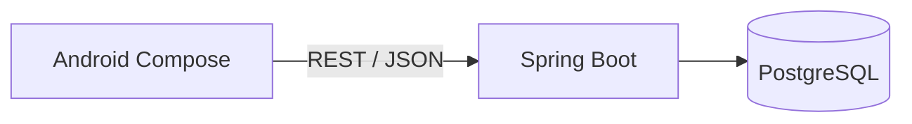

# Kiến trúc và ranh giới bộ khung

Luồng hiện thực: `MainActivity` → `StarterViewModel` → `SystemRepository` → Retrofit → `SystemController` → `SystemService` → `DatabaseProbe` → `SELECT 1`.

## Android

`presentation` quản lý UI; `domain` mô tả dữ liệu/giao diện Repository; `data` thực hiện gọi mạng. Hilt cấp dependencies. StateFlow mang trạng thái Loading/Ready/Error. Retry không tạo các yêu cầu trùng đang chạy. Room, DataStore, điều hướng, Maps và FCM sẽ được thêm khi có chức năng sử dụng.

## Backend

Một Spring Boot application, package theo nghiệp vụ. `system` là mẫu chạy được cho api/application/persistence. Các package nghiệp vụ có tài liệu phạm vi để thành viên triển khai dần. Chưa áp dụng Spring Modulith runtime hoặc tuyên bố đã kiểm tra dependency boundaries tự động.

Controller chỉ nhận/trả DTO; Service điều phối; Repository truy cập dữ liệu. Sau này các mô-đun chỉ giao tiếp qua service công khai. JPA đã được cấu hình nhưng chưa ánh xạ hàng loạt 33 bảng thành entity. Schema quản lý bởi Flyway, Hibernate chỉ validate các entity đã có.

## Bảo mật và tiền

API kỹ thuật kiểm tra trạng thái được public, không công khai chi tiết DB. Mọi đường khác bị chặn theo mặc định cho đến khi có auth thật. Spring Security trong bộ khung chưa cấp hoặc xác thực JWT; không dùng user/mật khẩu tự sinh của framework làm đăng nhập nghiệp vụ.

Khi bổ sung auth: refresh token lưu hash, có thu hồi; quyền luôn kiểm tra cả vai trò và cửa hàng. CSRF đang tắt cho API stateless; nếu thêm xác thực bằng cookie/browser phải thiết kế lại CSRF tương ứng.

Các quy tắc giữ hộp, hạn mức hoàn, callback xác thực, trạng thái đơn và bút toán cần transaction/khóa/kiểm thử ở backend. Các CHECK/FK trong V1 không thay thế toàn bộ nghiệp vụ. Không giữ transaction DB mở trong lúc gọi cổng thanh toán. FCM gửi thành công không tự đồng nghĩa khách đã nhận thông báo No-show.

## Chạy và cấu hình

Local dùng HTTP chỉ trên loopback; release cần HTTPS thật. Compose bind DB/API vào 127.0.0.1 để phục vụ phát triển. Đây chưa phải cấu hình production (chưa TLS proxy, backup, quản lý secrets, monitoring hay workers nghiệp vụ).

Tên bảng vật lý theo ERD tiếng Việt không dấu; Kotlin package/class và JSON kỹ thuật dùng tiếng Anh. Ví dụ DTO `orderId` ánh xạ cột `don_hang_id`; không cần đổi toàn bộ schema để đổi tên API.
